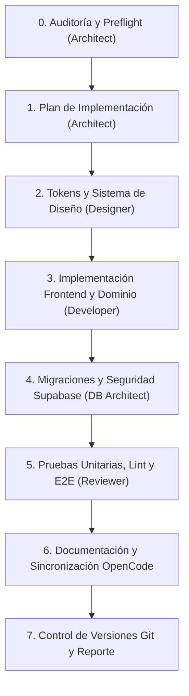

# Orquestación de Agentes y Flujo Operativo — LG_Artifacts

## 1. Modelo de Orquestación
El desarrollo autónomo en Antigravity sigue un flujo secuencial disciplinado basado en especificaciones formales, aseguramiento continuo y verificación antes de entrega.

## 2. Protocolo de Hand-off y Puertas de Verificación
1. **Paso 0 a Paso 1:** No se escribe código nuevo sin documentar las brechas en `auditoria-inicial.md`.
2. **Paso 1 a Paso 3:** No se implementa UI sin haber definido las funciones puras de dominio y los contratos de datos.
3. **Paso 3 a Paso 5:** Todo cambio de frontend debe pasar por `oxlint` y `vite build` antes de darse por completado.
4. **Paso 5 a Paso 7:** Las pruebas de Playwright deben validar la ausencia de errores en la consola del navegador y la correcta interacción de componentes.
