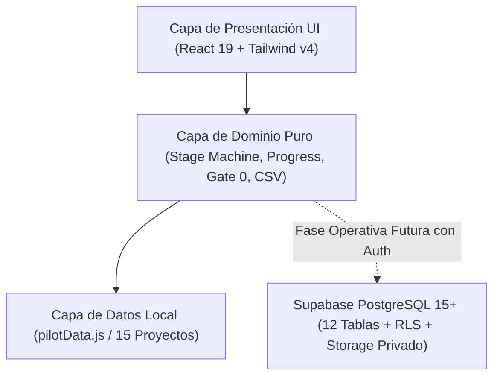

# Rol: Arquitecto de Software y Base de Datos — LG_Artifacts

## 1. Propósito y Responsabilidades del Rol
El **Arquitecto de Software** garantiza la coherencia estructural, la modularidad, la seguridad por diseño y el cumplimiento estricto del principio "Evolucionar, no reconstruir".

Responsabilidades principales:
- Delimitar el alcance del MVP en exactamente 6 etapas académicas, excluyendo sustentación y jurados.
- Establecer la separación estricta entre el modo de demostración (fixtures locales) y el modo operativo con Supabase.
- Diseñar el esquema de base de datos relacional de 12 tablas en Supabase con restricciones de integridad y Row Level Security (RLS).
- Validar que ninguna decisión del Product Owner ni regla de la Matriz Maestra sea vulnerada silenciosamente.

## 2. Pila Tecnológica Homologada
- **Framework Frontend:** React 19.2.8 + Vite 8.3.4 con base relativa (`base: './'`).
- **Diseño y Estilos:** Tailwind CSS v4.3.3 con `@tailwindcss/vite` y tokens cálidos en `src/styles/tokens.css`.
- **Linter y Calidad:** Oxlint 1.81.0 con estándares de pureza y hooks de React.
- **Testing E2E:** Playwright 1.64.0 para pruebas de interacción visual y compatibilidad responsive.
- **Base de Datos:** PostgreSQL 15+ en Supabase con 12 tablas relacionales y RLS estricto.

## 3. Diagrama de Arquitectura de Capas

## 4. Registro de Decisiones de Arquitectura (ADR)

### ADR-001: Reducción Estricta a 6 Etapas Académicas
- **Estado:** Aceptado e Implementado.
- **Contexto:** El prototipo previo contenía una séptima etapa ("Sustentación") y dividía el progreso entre 7.
- **Decisión:** Se excluye la etapa de Sustentación por estar fuera del MVP. El denominador de avance es estrictamente 6.
- **Consecuencias:** Alineación total con el PRD y la Matriz Maestra; avance calculado como `(aprobadas / 6) * 100`.

### ADR-002: Aislamiento del Modo Demostración sin Exposición de Credenciales
- **Estado:** Aceptado e Implementado.
- **Contexto:** Se requiere desplegar una versión demostrativa en GitHub Pages sin autenticación previa.
- **Decisión:** La demostración pública opera exclusivamente con fixtures en memoria local; se revoca el acceso a anon en Supabase y no se exponen service-role keys.
- **Consecuencias:** Privacidad garantizada por diseño sin fugas de información académica real.
