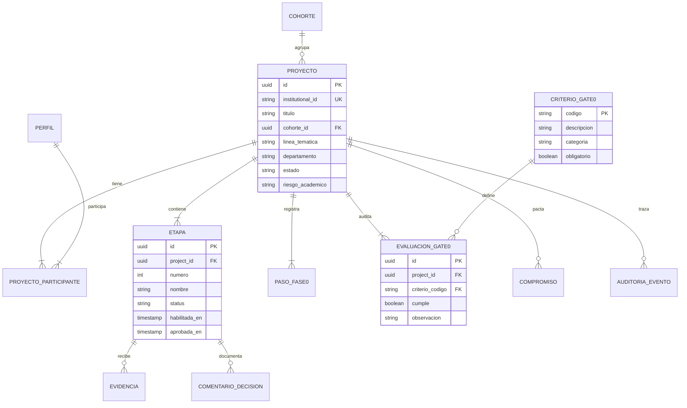

# Modelo de Datos Relacional — Supabase / PostgreSQL

**Versión:** 1.0  
**Fecha:** 14 de octubre de 2026  
**Documento Fuente:** `05_Backend_Data_Schema_Supabase.docx` y Hoja `12_Modelo_Supabase`  
**Entregable:** `docs/database/modelo-datos.md`  

---

## 1. Diagrama de Entidad-Relación (Mermaid)

---

## 2. Catálogo de las 12 Entidades Relacionales

| ID | Nombre de Entidad | Clave Primaria | Finalidad Académica y Control |
|---|---|---|---|
| **DB-01** | `perfil` | `id UUID` | Almacena estudiantes, tutores y administradores. Enlaza con `auth.users` en fase operativa. |
| **DB-02** | `cohorte` | `id UUID` | Agrupación académica semestral (ej. `2026-I`). |
| **DB-03** | `proyecto` | `id UUID` | Tesis o trabajo de grado único, línea de investigación y metadatos Dublin Core. |
| **DB-04** | `proyecto_participante` | `id UUID` | Control de membresía N:M entre usuarios y proyectos, identificando al tutor principal. |
| **DB-05** | `etapa` | `id UUID` | Exactamente 6 etapas por proyecto (`UNIQUE(project_id, numero)`). Denominador de avance. |
| **DB-06** | `paso_fase0` | `id UUID` | 17 actividades metodológicas consecutivas para la preparación de la tesis. |
| **DB-07** | `criterio_gate0` | `codigo TEXT` | Catálogo maestro de 14 criterios de salida de protocolo (`G0-01` a `G0-14`). |
| **DB-08** | `evaluacion_gate0` | `id UUID` | Dictamen de cumplimiento de cada criterio Gate 0 por proyecto (`UNIQUE(project_id, criterio)`). |
| **DB-09** | `evidencia` | `id UUID` | Metadatos de archivos entregados, numeración de versiones inmutables y llaves de Storage. |
| **DB-10** | `comentario_decision` | `id UUID` | Historial inmutable de observaciones obligatorias, acuerdos y dictámenes del tutor. |
| **DB-11** | `compromiso` | `id UUID` | Acuerdos pactados con responsable y fecha límite de entrega. |
| **DB-12** | `auditoria_evento` | `id UUID` | Registro de trazabilidad de cambios de estado y acciones del sistema. |
