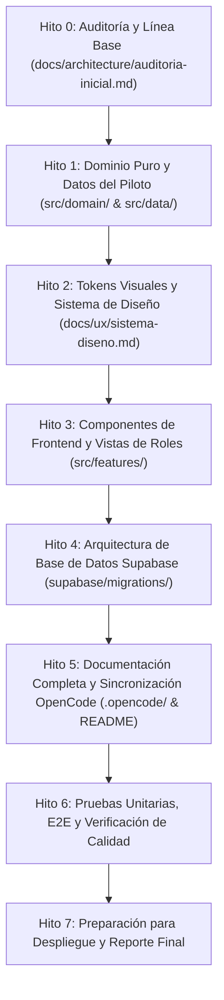

# Plan de Implementación del MVP — Seguimiento Académico de Trabajos de Grado

**Fecha:** 14 de octubre de 2026  
**Versión:** 1.0  
**Autor:** Antigravity Architect & Senior Engineering Team  
**Rama:** `feat/seguimiento-academico-mvp`  
**Entregable:** `docs/implementation/plan.md`  

---

## 1. Alcance y Fronteras del MVP

### 1.1 Incluido en el MVP
* **Roles del Piloto:** Estudiante, Tutor y Administrador de Plataforma (con selector de simulación para entorno demo).
* **Capacidad del Piloto:** 15 estudiantes, 15 proyectos académicos y 3 tutores (Cohorte 2026-I).
* **Flujo de 6 Etapas Académicas:**
  1. Propuesta / Protocolo (con verificación Gate 0).
  2. Marco Teórico.
  3. Metodología.
  4. Recolección.
  5. Análisis.
  6. Documento Final.
* **Cálculo de Progreso Académico:** `Progreso = (etapasAprobadas / 6) * 100` (valores escalonados: 0%, 17%, 33%, 50%, 67%, 83%, 100%).
* **Preparación Metodológica Fase 0:** Las 17 actividades consecutivas organizadas y guiadas para la etapa 1.
* **Protocolo de Salida Gate 0:** Los 14 criterios oficiales de verificación para la etapa 1. Regla: 14/14 conformes habilita la decisión del tutor, nunca auto-aprueba.
* **Gestión de Evidencias:** Carga simulada, versionado inmutable (v0.1, v1.0, v1.1...), metadatos y trazabilidad.
* **Revisión del Tutor:** Dictamen de aprobación o solicitud de cambios (observación obligatoria no vacía).
* **Bitácora y Compromisos:** Registro inmutable de acuerdos, fechas límite y cambios de estado.
* **Exportación CSV:** Compatible con Excel, con codificación UTF-8 BOM y neutralización de inyección de fórmulas (`=`, `+`, `-`, `@`).
* **Arquitectura de Base de Datos Supabase:** Migraciones versionadas DDL con 12 tablas relacionales, constraints, triggers de auditoría, seed reproducible para los 15 proyectos y políticas RLS restrictivas preparadas para el futuro Auth.

### 1.2 Exclusiones Explícitas (Fuera de Alcance)
* Repositorio institucional masivo o motor de búsqueda bibliográfica.
* Sustentación oral y asignación de jurados calificadores.
* Autenticación operativa en producción (login real por email/contraseña).
* Acceso público anónimo a documentos académicos privados.
* Módulos de analítica predictiva avanzada no especificados.

---

## 2. Estrategia de Refactorización y Evolución

### 2.1 Código a Preservar
* Lógica de gestión de estado reactivo y visualización por stepper.
* Primitivas de interfaz (tarjetas, badges de estado, modales, toasts de notificación).
* Estructura de despliegue en Vite (`base: './'`) y GitHub Actions (`deploy.yml`).
* Configuración de linters (`oxlint`) y suites de Playwright (`verify-app.mjs`).

### 2.2 Refactorizaciones Mandatorias
* **Desmonolito de `FichaProyecto.jsx`:** Extraer la lógica de dominio puro a módulos testeables independientes (`src/domain/`) y los componentes de vista a subcarpetas de características (`src/features/`).
* **Corrección de Etapas:** Reducir de 7 a exactamente 6 etapas académicas.
* **Corrección de la Fórmula de Avance:** Base 6 en lugar de base 7.
* **Español 100% Nativo:** Reemplazar todas las cadenas en inglés en UI, botones, badges, modales y exportaciones.
* **Tokens Visuales Cálidos:** Implementar paleta de diseño institucional (`#FAF7F2`, `#704733`, `#F3ECE3`, `#253240`) conforme al Design Brief.
* **Catálogo de 15 Proyectos:** Implementar portafolio para Tutor y Administrador con selector de proyectos y filtros por cohorte y estado.

---

## 3. Arquitectura Modular Propuesta

```
src/
├── domain/                      # Funciones puras de lógica de negocio (sin dependencias de React)
│   ├── stageMachine.js          # Transiciones de estado (pendiente -> en_revision -> observado -> aprobado)
│   ├── progressCalculator.js    # Progreso sobre 6 etapas y cálculo de riesgos
│   ├── gate0Validator.js        # Validación de 14 criterios de Gate 0 y 17 pasos Fase 0
│   └── csvExporter.js           # Generación de CSV con UTF-8 BOM y mitigación de inyección
├── data/                        # Datos semilla y catálogo de piloto
│   ├── pilotData.js             # 15 proyectos, 18 usuarios, 6 etapas por proyecto, historial inicial
│   ├── phase0Catalog.js         # Catálogo de las 17 actividades de Fase 0
│   └── gate0Catalog.js          # Catálogo canónico de los 14 criterios de Gate 0
├── styles/
│   └── tokens.css               # Variables CSS de diseño cálido institucional
├── features/                    # Componentes modulares de interfaz de usuario
│   ├── navigation/
│   │   ├── TopNav.jsx           # Navegación superior con selector de roles y banner de entorno demo
│   │   └── DemoNoticeBanner.jsx # Indicador de datos ficticios / sin autenticación real
│   ├── projects/
│   │   ├── ProjectCard.jsx      # Tarjeta resumen de proyecto para portafolios
│   │   ├── ProjectHeader.jsx    # Cabecera de metadatos Dublin Core del proyecto
│   │   └── ProjectPortfolio.jsx # Vista de portafolio para Tutor y Administrador (15 proyectos)
│   ├── stages/
│   │   ├── StageStepper.jsx     # Selector de las 6 etapas académicas con badges
│   │   └── StageDetail.jsx      # Detalle de la etapa activa y acciones permitidas
│   ├── phase0/
│   │   └── Phase0Modal.jsx      # Panel interactivo de las 17 actividades metodológicas de Fase 0
│   ├── gate0/
│   │   └── Gate0Drawer.jsx      # Modal de auditoría de los 14 criterios de Gate 0
│   ├── evidence/
│   │   └── EvidenceList.jsx     # Gestión de archivos entregados y versiones
│   ├── review/
│   │   └── TutorReviewModal.jsx # Interfaz para solicitar cambios u otorgar aprobación formal
│   ├── bitacora/
│   │   └── BitacoraView.jsx     # Registro cronológico de decisiones y compromisos
│   └── admin/
│       └── AdminView.jsx        # Tablero general de cohortes, tutores y métricas del piloto
├── App.jsx                      # Orquestador principal de estado y vistas
├── main.jsx                     # Montaje React
└── index.css                    # Estilos globales y tokens
```

---

## 4. Plan de Ejecución por Hitos



### Detalle de los Hitos:

1. **Hito 1 — Dominio y Datos (Lógica Pura):**
   * Crear `src/domain/stageMachine.js`, `progressCalculator.js`, `gate0Validator.js`, `csvExporter.js`.
   * Crear `src/data/pilotData.js` con los 15 proyectos ficticios de la cohorte 2026-I, 15 estudiantes, 3 tutores y 1 administrador.
   * Crear catálogos completos de Fase 0 (17 actividades) y Gate 0 (14 criterios).

2. **Hito 2 — Sistema de Diseño y Tokens:**
   * Crear `src/styles/tokens.css` e integrarlo en `src/index.css`.
   * Redactar `docs/ux/sistema-diseno.md`.

3. **Hito 3 — Frontend Modular y Vistas:**
   * Implementar `TopNav`, `DemoNoticeBanner`, `ProjectPortfolio`, `ProjectHeader`, `StageStepper`, `Phase0Modal`, `Gate0Drawer`, `EvidenceList`, `TutorReviewModal`, `BitacoraView`, `AdminView`.
   * Integrar en `src/App.jsx` garantizando 100% idioma español, fluidez de interacción y diseño adaptativo (1440px, 1024px, 768px, 390px).

4. **Hito 4 — Base de Datos Supabase:**
   * Crear migración SQL `supabase/migrations/20261014000000_schema_inicial.sql` con las 12 entidades relacionales, constraints, triggers de auditoría y RLS restrictivo.
   * Crear `supabase/seed.sql` con los 15 proyectos y datos de prueba.
   * Crear `supabase/README.md`, `docs/database/modelo-datos.md` y `docs/database/seguridad.md`.

5. **Hito 5 — Documentación y Sincronización OpenCode:**
   * Actualizar `.opencode/context/`, `.opencode/specifications/`, `.opencode/roles/`, `.opencode/orchestration/`.
   * Actualizar `.agent/rules/`, `.agent/skills/`, `.agent/workflows/`.
   * Actualizar `README.md` raíz y `docs/README.md`.

6. **Hito 6 — Verificación y Pruebas:**
   * Pruebas unitarias de dominio con Node.js / script de testing.
   * Pruebas E2E de interfaz y accesibilidad con Playwright (`verify-app.mjs`).
   * Validación de build (`npm run build`) y lint (`npm run lint`).

7. **Hito 7 — Control de Versiones y Entrega:**
   * Commits ordenados por hito en la rama `feat/seguimiento-academico-mvp`.
   * Generación del informe final en español conforme al Master Prompt.

---

## 5. Matriz de Criterios de Aceptación (QA)

| Código | Descripción de la Prueba | Resultado Esperado |
|---|---|---|
| **QA-01** | Carga inicial del proyecto | Muestra 6 etapas académicas y progreso 0% en proyectos nuevos. |
| **QA-02** | Cálculo de progreso en base 6 | Al aprobar etapas 0, 1, 3, 6, el progreso refleja exactamente 0%, 17%, 50%, 100%. |
| **QA-03** | Gate 0 incompleto (ej. 13/14) | Bloquea la aprobación de la etapa 1 y resalta los criterios faltantes. |
| **QA-04** | Gate 0 completo (14/14) | Habilita el botón de dictamen del tutor; NO auto-aprueba la etapa. |
| **QA-05** | Solicitud de cambios | Exige observación no vacía; cambia estado a "observado" y registra en bitácora. |
| **QA-06** | Carga de corrección por estudiante | Cambia estado a "en_revision", conserva evidencia previa y registra entrada de versión. |
| **QA-07** | Salto de etapas prohibido | Etapas pendientes bloqueadas; solo se aprueba la etapa activa si la anterior está aprobada. |
| **QA-08** | Exportación CSV segura | Incluye UTF-8 BOM y neutraliza fórmulas que comiencen con `=`, `+`, `-`, `@`. |
| **QA-09** | Portafolio del piloto | Tutor visualiza sus proyectos asignados; Administrador visualiza los 15 proyectos. |
| **QA-10** | Privacidad y modo demo | Banner visible advirtiendo datos ficticios sin acceso anónimo a bases privadas. |
| **QA-11** | Responsividad y a11y | Operable en escritorio (1440/1024px) y móviles (768/390px); contraste accesible. |
| **QA-12** | Compilación limpia | `npm run lint` sin errores y `npm run build` genera bundle sin fallos. |

---

## 6. Riesgos y Decisiones Técnicas Bloqueantes

1. **Riesgo de persistencia de datos demo:**
   * *Mitigación:* Se utiliza almacenamiento local en memoria (`useState`) enriquecido con `localStorage` opcional, manteniendo la desconexión total de bases productivas hasta contar con autenticación formal.
2. **Riesgo de desalineación en Gate 0 y Fase 0:**
   * *Mitigación:* Se implementan como dos estructuras separadas y vinculadas: las 17 actividades metodológicas de preparación y los 14 criterios de dictamen evaluativo.
3. **Riesgo de sobreingeniería:**
   * *Mitigación:* Aplicar la regla `ponytail`: React puro, funciones de dominio reutilizables, sin agregar librerías de estado globales pesadas ni dependencias externas innecesarias.
